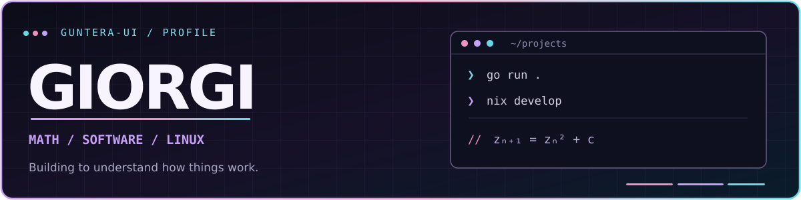
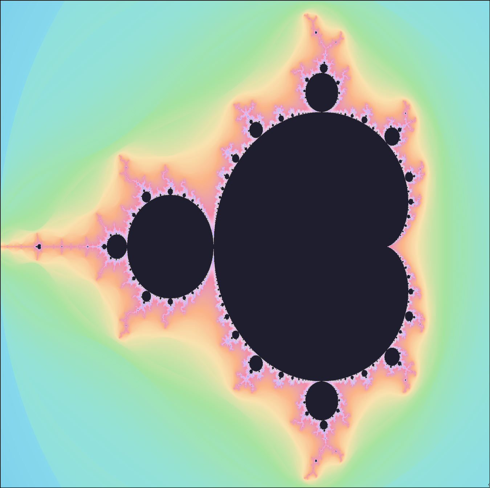

 

<strong>Mathematical visualization · Terminal applications · Reproducible Linux systems</strong>

I like understanding the systems I use, then building things of my own.

  

&nbsp;
&nbsp;

 

## <code>01 /</code> The workspace

<table>
<tr>
<td width="56%" valign="top">
  <h3>What I work on</h3>
  
I build <strong>terminal-first software</strong>, explore mathematical graphics, and configure my own Linux environments.

  
I'm interested in systems that are understandable from the inside: algorithms, rendering pipelines, keyboard-driven tools, and hardware interfaces.

</td>
<td width="44%" valign="top">
  <h3>Currently exploring</h3>
  
↳ &nbsp;<strong>Go</strong> for tools and visual computation 
  ↳ &nbsp;<strong>NixOS</strong> for reproducible systems 
  ↳ &nbsp;<strong>ESP32</strong> for connected hardware 
  ↳ &nbsp;<strong>Mathematics</strong> through code

</td>
</tr>
</table>

---

## <code>02 /</code> Featured work

<table>
<tr>
<td width="52%" valign="top">
01 — VISUAL COMPUTING / FEATURED PROJECT
<h2><a href="https://github.com/Guntera-ui/FractalForge">FractalForge ↗</a></h2>

<strong>Explore the Mandelbrot set from your terminal.</strong>

A Go application with keyboard navigation, multiple color palettes, and rendering through the Kitty graphics protocol. Multicore refinement keeps the experience interactive as detail increases.

<a href="https://github.com/Guntera-ui/FractalForge"><strong>Browse source &amp; documentation →</strong></a>

</td>
<td width="48%" valign="middle" align="center">

 REAL FRACTALFORGE RENDER · <code>zₙ₊₁ = zₙ² + c</code>
</td>
</tr>
</table>

<table>
<tr>
<td width="50%" valign="top">
  

  02 — LINUX / SYSTEMS
  <h3><a href="https://github.com/Guntera-ui/Nixos">NixOS configurations ↗</a></h3>
  
A customized <strong>Hyprland + Home Manager</strong> environment managed declaratively with flakes.

  
Separate desktop and ASUS hybrid-graphics configurations, with AMD as the desktop GPU and NVIDIA PRIME offload for demanding applications.

  
<code>Nix</code> &nbsp; <code>Hyprland</code> &nbsp; <code>Lua</code>

  
<a href="https://github.com/Guntera-ui/Nixos/tree/main">Desktop branch →</a> &nbsp; · &nbsp; <a href="https://github.com/Guntera-ui/Nixos/tree/hybrid">Hybrid branch →</a>

</td>
<td width="50%" valign="top">
  

  03 — PYTHON / BUILD TOOLS
  <h3><a href="https://github.com/Guntera-ui/StaticSiteGenerator">Static Site Generator ↗</a></h3>
  
A Markdown-to-HTML generator written in Python.

  
Built around content parsing, templates, reusable assets, and publishing static pages to GitHub Pages.

  
<code>Python</code> &nbsp; <code>Markdown</code> &nbsp; <code>HTML</code>

  
<a href="https://github.com/Guntera-ui/StaticSiteGenerator">Explore repository →</a>

</td>
</tr>
</table>

---

## <code>03 /</code> Toolbox

LANGUAGES &amp; SYSTEMS

EDITOR &amp; WORKFLOW

HARDWARE &amp; CREATIVE TOOLS

&nbsp; <code>ESP32</code> &nbsp; <code>KiCad</code> &nbsp; <code>FreeCAD</code> &nbsp; <code>Kitty</code>

---

## <code>04 /</code> On the workbench

<table>
<tr>
<td width="50%" valign="top">
  <b>Mathematical software</b> 
  Fractals, numerical experiments, computational visualization.
</td>
<td width="50%" valign="top">
  <b>Hardware × software</b> 
  Small ESP32 devices, sensors, custom PCBs, connected prototypes.
</td>
</tr>
<tr>
<td width="50%" valign="top">
  <b>Terminal interfaces</b> 
  Keyboard-native tools with a deliberate, minimal interaction model.
</td>
<td width="50%" valign="top">
  <b>Reproducible development</b> 
  Flakes, development shells, hardware-specific NixOS modules.
</td>
</tr>
</table>

 

<code>BUILD</code> &nbsp; ── &nbsp; <code>UNDERSTAND</code> &nbsp; ── &nbsp; <code>REFINE</code>

  

<a href="https://github.com/Guntera-ui?tab=repositories"><strong>Explore my repositories ↗</strong></a>

