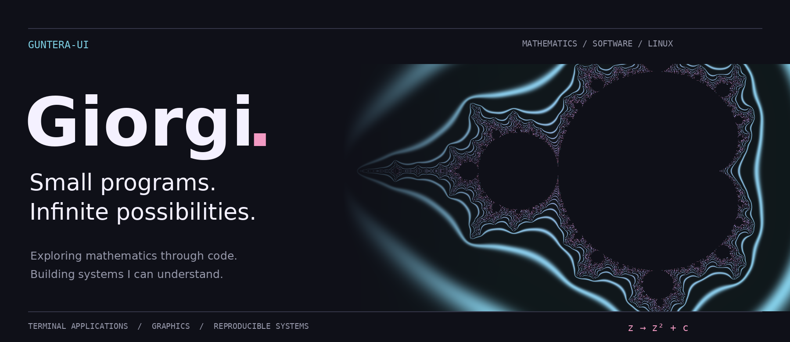

  

  <a href="https://github.com/Guntera-ui/FractalForge">Explore FractalForge ↗</a>
  &nbsp;&nbsp; / &nbsp;&nbsp;
  <a href="https://github.com/Guntera-ui/Nixos">Inside my NixOS setup ↗</a>

 

### [FractalForge ↗](https://github.com/Guntera-ui/FractalForge)

**An infinite landscape, inside a terminal.**

A keyboard-driven Mandelbrot explorer written in Go. Navigate the complex plane with Kitty graphics, adjustable palettes, and multicore progressive rendering.

`Go` &nbsp; `Mathematics` &nbsp; `Terminal graphics`

[Explore the source →](https://github.com/Guntera-ui/FractalForge)

 

### [NixOS / dotfiles ↗](https://github.com/Guntera-ui/Nixos)

**A system described in code.**

Reproducible environments for a desktop and a hybrid-graphics laptop. Built around flakes, Home Manager, and Hyprland, with AMD/NVIDIA PRIME on the laptop.

`Nix` &nbsp; `Linux` &nbsp; `Hyprland`

[Desktop configuration →](https://github.com/Guntera-ui/Nixos/tree/main) &nbsp; / &nbsp; [Hybrid laptop →](https://github.com/Guntera-ui/Nixos/tree/hybrid)

 

### [Static Site Generator ↗](https://github.com/Guntera-ui/StaticSiteGenerator)

**From plain text to a published page.**

A Python generator that turns Markdown into HTML, bringing together templates, static assets, and GitHub Pages publishing.

`Python` &nbsp; `Markdown` &nbsp; `HTML`

[Explore the source →](https://github.com/Guntera-ui/StaticSiteGenerator)

 

**Languages** &nbsp; Go · Python · Lua · Nix  
**Environment** &nbsp; Linux · Neovim · Kitty · Git · GitHub  
**Hardware** &nbsp; Arduino · ESP32

 

---

Mathematics gives me the questions. Building things helps me understand the answers.

