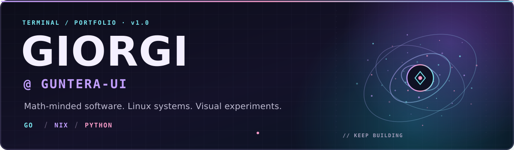
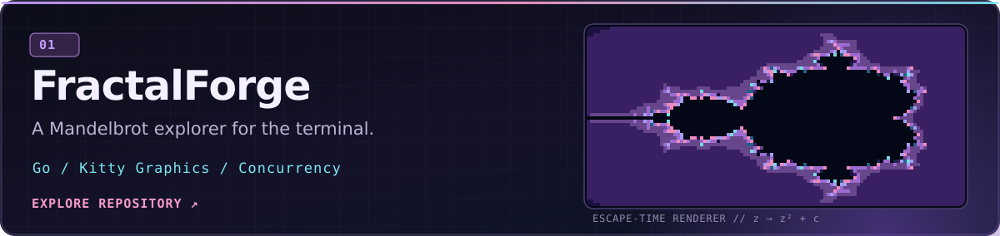
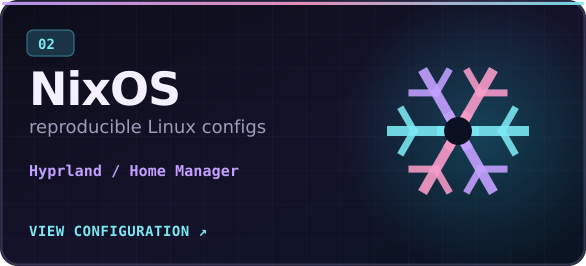
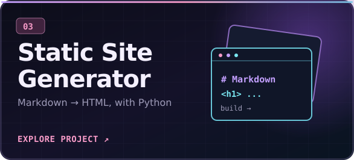

<div align="center">



<br />

**I like making mathematical ideas visible and computer systems understandable.**

[](https://github.com/Guntera-ui?tab=repositories) [](https://github.com/Guntera-ui/Nixos) [](https://github.com/Guntera-ui/FractalForge)

</div>

### `> whoami`

I'm **Giorgi** (`Guntera-ui`). I enjoy writing software that connects **mathematics**, **systems programming**, and **visual computing**. I also spend a questionable amount of time making my Linux desktop feel exactly right.

- **Building:** terminal-first applications and mathematical visualizations.
- **Running:** NixOS + Hyprland, with declarative configuration and reproducible environments.
- **Exploring:** Go, embedded electronics, graphics, and the internals behind everyday tools.

<br />

### `> ls ~/projects`

<a href="https://github.com/Guntera-ui/FractalForge"></a>

<sub>An interactive Mandelbrot-set explorer with Kitty graphics rendering, keyboard navigation, multiple palettes, and multicore tile-based refinement.</sub>

<br /><br />

<table>
<tr>
<td width="50%" valign="top">
<a href="https://github.com/Guntera-ui/Nixos"></a>
<br />
<sub>My declarative NixOS environment, with desktop and hybrid AMD/NVIDIA configurations.</sub>
</td>
<td width="50%" valign="top">
<a href="https://github.com/Guntera-ui/StaticSiteGenerator"></a>
<br />
<sub>A Markdown-to-HTML site generator with templates, assets, and GitHub Pages deployment.</sub>
</td>
</tr>
</table>

<br />

### `> cat toolkit.txt`

**Languages & tools**


`Kitty` · `Hyprland` · `Neovim` · `Home Manager` · `Flakes` · `GitHub Pages`

<br />

### `> focus --now`

```text
01  Mathematics in the terminal    →  exploring graphics, rendering and interaction
02  Reproducible systems            →  maintaining and refining my NixOS setup
03  Learning by building           →  small, useful tools from the ground up
```

<div align="center">


<sub><code>make it work</code> → <code>understand it</code> → <code>make it better</code></sub>

<br /><br />

<a href="https://github.com/Guntera-ui?tab=repositories">Browse all repositories →</a>

</div>
