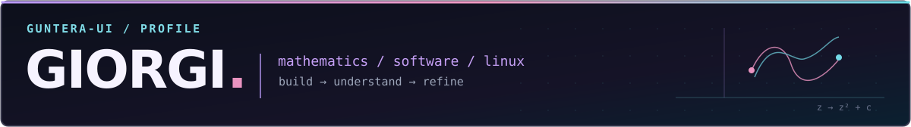

<strong>Making mathematical ideas visible and computer systems understandable.</strong> 
I build terminal applications, explore graphics, and maintain reproducible Linux environments.

<a href="https://github.com/Guntera-ui/FractalForge">FractalForge</a> &nbsp;·&nbsp; <a href="https://github.com/Guntera-ui/Nixos">NixOS</a> &nbsp;·&nbsp; <a href="https://github.com/Guntera-ui/StaticSiteGenerator">Static Site Generator</a>

### Selected work

<table>
<tr>
<td width="34%" valign="middle" align="center">

</td>
<td width="66%" valign="middle">
FEATURED PROJECT · GO / MATHEMATICS
<h3><a href="https://github.com/Guntera-ui/FractalForge">FractalForge ↗</a></h3>

A keyboard-driven Mandelbrot explorer for the terminal. Built in Go with Kitty graphics, adjustable palettes, and multicore progressive rendering.

<code>Go</code> &nbsp; <code>Fractals</code> &nbsp; <code>Terminal graphics</code>

<a href="https://github.com/Guntera-ui/FractalForge">Source &amp; documentation →</a>
</td>
</tr>
</table>

<table>
<tr>
<td width="50%" valign="top">
<strong><a href="https://github.com/Guntera-ui/Nixos">NixOS / dotfiles ↗</a></strong> 
Flakes · Hyprland · Home Manager · AMD/NVIDIA PRIME 
<small>Declarative environments for desktop and hybrid-graphics laptop.</small> 
<a href="https://github.com/Guntera-ui/Nixos/tree/main">desktop</a> · <a href="https://github.com/Guntera-ui/Nixos/tree/hybrid">hybrid</a>
</td>
<td width="50%" valign="top">
<strong><a href="https://github.com/Guntera-ui/StaticSiteGenerator">Static Site Generator ↗</a></strong> 
Python · Markdown · HTML 
<small>A Markdown-to-HTML generator with templates, assets, and GitHub Pages publishing.</small>
</td>
</tr>
</table>

### Toolbox

Also working with Kitty · KiCad · FreeCAD · ESP32 · Blender

